# 🪙 JOHN WICK & CO. ARMS — Continental Tactical Armory & Management System

[](https://www.php.net/)
[](https://www.mysql.com/)
[](https://www.docker.com/)
[](https://vercel.com/)
[](https://render.com/)
[](#-license)


> [!TIP]
> ### 🌐 Live Production Deployment
> - **Main Application**: **[https://john-wick-arms.onrender.com/](https://john-wick-arms.onrender.com/)**
> - **Admin Command Desk**: **[https://john-wick-arms.onrender.com/admin_preview/dashboard.html](https://john-wick-arms.onrender.com/admin_preview/dashboard.html)**
> - **GitHub Repository**: **[https://github.com/akash-07-git-io/john-wick-arms](https://github.com/akash-07-git-io/john-wick-arms)**

> *"Tactical precision. Crimson steel. Excommunicado protection."*  
> Inspired by the high-precision cinematic world of the Continental and High Table Armory, **John Wick & Co. Arms** is an end-to-end, enterprise-grade Weapon Management & Requisition System developed for **Web Programming (Assignment II)**.

---

## 📌 Table of Contents
1. [Executive Summary & Concept](#-executive-summary--concept)
2. [Live Demos & Repository Links](#-live-demos--repository-links)
3. [Technology Stack](#-technology-stack)
4. [System Architecture & Directory Tree](#-system-architecture--directory-tree)
5. [The 18 Authentic Tactical Weapons](#-the-18-authentic-tactical-weapons)
6. [Visual Walkthrough & Screenshot Gallery](#-visual-walkthrough--screenshot-gallery)
7. [Relational Database Schema & Data Dictionary](#-relational-database-schema--data-dictionary)
8. [Setup & Installation Instructions](#-setup--installation-instructions)
   - [Method 1: Local XAMPP / WAMP Setup](#method-1-local-xampp--wamp-setup)
   - [Method 2: 1-Click Docker Compose (Port 3000)](#method-2-1-click-docker-compose-port-3000)
9. [Free-Tier Cloud Deployment Guide](#-free-tier-cloud-deployment-guide)
   - [Vercel Deployment (Interactive Frontend & Previews)](#vercel-deployment-frontend)
   - [Render Cloud Deployment (Dockerized PHP & MySQL)](#render-cloud-deployment-full-stack)
10. [Default Credentials & Test Accounts](#-default-credentials--test-accounts)
11. [Academic Assignment Scope & Legal Disclaimer](#-academic-assignment-scope--legal-disclaimer)
12. [License](#-license)

---

## 🏛️ Executive Summary & Concept

The **John Wick & Co. Arms** platform simulates the private procurement portal accessible only to High Table members and Continental hotel guests holding sovereign markers.

### Core Modules:
- **Client Armory Requisition Portal**:
  - Sommelier Featured Showcase & High Table Event bulletins.
  - 18 Authentic weapons categorized into **Sidearms**, **Shotguns**, **Submachine Guns**, and **Rifles**.
  - Deep technical specs view (Caliber, Muzzle Velocity, Capacity, Sommelier Tasting Notes).
  - Session-based Requisition Ledger (Cart) with real-time totals in both **USD ($)** and **Continental Gold Coins (🪙)**.
  - Multi-channel Checkout featuring 5 professional payment methods:
    1. *Continental Gold Coins (Direct Vault Marker)*
    2. *High Table Encrypted Card (Black Card)*
    3. *Cryptocurrency Escrow (BTC / XMR)*
    4. *Swiss Bank Wire Transfer*
    5. *Continental Safehouse COD*
  - Operative Registration capturing Clearance Tiers, Blood Oath Marker codes, and Duty Stations.
  - Operative Portal with 1-Click test auto-fill (`wick@continental.com`).
  - Historical order tracking with real-time status badges (*Pending*, *Processing*, *Dispatched*, *Delivered*).

- **Admin Armory Command Center**:
  - High Table Administrator authentication (`admin` / `admin123`).
  - Real-time Analytics Dashboard: Total Weapons, Total Orders, Registered Operatives, and Revenue.
  - Complete Inventory CRUD (Create, Read, Update, Delete) with image previews and stock status toggles.
  - Order Fulfillment Command: View line-item orders and update statuses inline.

---

## 🌐 Live Demos & Repository Links

| Destination | Purpose | URL |
| :--- | :--- | :--- |
| **GitHub Repository** | Source code & version control | [https://github.com/akash-07-git-io/john-wick-arms](https://github.com/akash-07-git-io/john-wick-arms) |
| **Vercel Showcase** | Fast interactive static frontend & Admin preview | Deployable via Vercel Free Tier (`vercel.json`) |
| **Render Web Service** | Full containerized PHP 8.2 + Apache web service | Deployable via Render Free Tier (`render.yaml`) |
| **Docker Hub / Compose** | 1-Click isolated local container stack | Configured on Port `3000` (`docker-compose.yml`) |

---

## 🛠️ Technology Stack

```text
┌─────────────────────────────────────────────────────────────┐
│                       FRONTEND LAYER                        │
│   • Semantic HTML5 & Modern Responsive CSS3                 │
│   • Custom Continental Luxury Palette (Charcoal, Gold, Red) │
│   • Vanilla JavaScript (ES6+) for DOM & Live Cart Ledger     │
│   • Cinzel & Inter Typography via Google Fonts              │
└──────────────────────────────┬──────────────────────────────┘
                               │ HTTP / JSON / POST
┌──────────────────────────────▼──────────────────────────────┐
│                    APPLICATION BACKEND                      │
│   • PHP 8.2 (Apache 2.4 mod_php / Dockerized)               │
│   • Native PHP Sessions for State & Cart Management          │
│   • Prepared SQL Statements with PDO / MySQLi               │
│   • Input Sanitization & Password Hashing (BCrypt)          │
└──────────────────────────────┬──────────────────────────────┘
                               │ TCP / 3306
┌──────────────────────────────▼──────────────────────────────┐
│                       DATABASE TIER                         │
│   • MySQL 8.0 / MariaDB Relational Database                 │
│   • InnoDB Storage Engine with Foreign Key Constraints      │
│   • Cascading Deletes on Orders & Order Line Items          │
└─────────────────────────────────────────────────────────────┘
```

---

## 📁 System Architecture & Directory Tree

```text
john-wick-arms/
├── admin/                         # Backend Admin Management Module (PHP)
│   ├── add_weapon.php             # Create firearm catalog entry
│   ├── admin_footer.php           # Admin panel shared footer
│   ├── admin_header.php           # Admin authentication gate & navbar
│   ├── dashboard.php              # Analytics KPIs, metrics & recent requisitions
│   ├── edit_weapon.php            # Update specs, pricing, and stock status
│   ├── index.php                  # Admin login portal
│   ├── logout.php                 # Terminates administrative session
│   ├── orders.php                 # Order ledger with status filter & inline updates
│   ├── order_detail.php           # Line-item inspector for customer orders
│   └── weapons.php                # Weapon inventory table with CRUD controls
├── admin_preview/                 # Static HTML mirrors for zero-backend hosting
│   ├── add_weapon.html            # Static preview of add weapon form
│   ├── dashboard.html             # Static preview of admin metrics
│   ├── db_schema.html             # Visual representation of database tables
│   ├── edit_weapon.html           # Static preview of weapon modification
│   ├── login.html                 # Static preview of admin login
│   ├── orders.html                # Static preview of admin orders
│   └── weapons.html               # Static preview of weapons CRUD
├── css/
│   └── styles.css                 # Master stylesheet (Gold & Obsidian theme)
├── database/
│   └── john_wick_arms.sql         # Production schema + 18 authentic weapon seeds
├── images/                        # High-resolution tactical weapon photography
│   ├── benelli_m4.jpg             # Benelli M4 Tactical Shotgun
│   ├── bt_apc9.jpg                # B&T APC9 PRO-K SMG
│   ├── cheytac_m200.jpg           # CheyTac M200 Intervention Sniper
│   ├── combat_master_jw2.jpg      # TTI Combat Master Glock 34 (JW2)
│   ├── cz_scorpion.jpg            # CZ Scorpion EVO 3 S1 SMG
│   ├── desert_tech_srs.jpg        # Desert Tech SRS-A1 Bullpup Rifle
│   ├── gen12_dragons_breath.jpg   # Genesis Arms Gen-12 Dragon's Breath (JW4)
│   ├── glock26.jpg                # Glock 26 Combat Master Backup
│   ├── hk_mp5k.jpg                # Heckler & Koch MP5K-PDW
│   ├── hk_p30l.jpg                # H&K P30L Compensated (JW1)
│   ├── keltec_ksg.jpg             # Kel-Tec KSG Bullpup Shotgun
│   ├── kimber_1911.jpg            # Kimber 1911 Warrior .45 ACP
│   ├── pit_viper.jpg              # TTI JW4 Pit Viper 9mm
│   ├── remington870.jpg           # Remington 870 Tactical Breacher
│   ├── sig_mcx.jpg                # SIG Sauer MCX Virtus Patrol
│   ├── sig_mpx.jpg                # SIG MPX TTI Suppressed Spec
│   ├── sti_2011_jw3.jpg           # TTI STI 2011 Combat Master (JW3)
│   └── tti_tr1.jpg                # TTI TR-1 Ultralight AR-15
├── includes/                      # Reusable PHP customer view components
│   ├── footer.php                 # Global Continental footer & legal notices
│   └── header.php                 # Top navigation, session auth & cart counter
├── js/
│   ├── app.js                     # Dynamic client behavior & UI controllers
│   ├── catalog-data.js            # Offline dataset for static armory mode
│   └── validation.js              # Real-time form validator for checkout & register
├── screenshots/                   # 16 High-resolution verification captures
│   ├── screenshot_01_home.png
│   ├── screenshot_02_catalog.png
│   ├── ...
│   └── screenshot_16_db_schema.png
├── cart.php                       # Customer Requisition Ledger (Cart)
├── cart_action.php                # Session cart controller (add/update/remove/clear)
├── catalog.php                    # Armory catalog with live category filtering
├── checkout.php                   # Requisition settlement & safehouse delivery form
├── db_connect.php                 # Universal MySQL database connection wrapper
├── docker-compose.yml             # Docker multi-container specification (Port 3000)
├── Dockerfile                     # PHP 8.2-Apache production image definition
├── index.html                     # Standalone interactive Single-Page Armory
├── index.php                      # Dynamic PHP Home Portal
├── login.php                      # Customer authentication with 1-click test fill
├── logout.php                     # Customer session teardown
├── my_orders.php                  # Operative order history & live delivery tracker
├── order_success.php              # Order confirmation & dispatch receipt
├── render.yaml                    # Render Cloud Blueprint specification
├── vercel.json                    # Vercel static rewrites configuration
├── weapon_detail.php              # Technical specifications & sommelier notes
└── README.md                      # Comprehensive documentation (this file)
```

---

## 🎯 The 18 Authentic Tactical Weapons

Every weapon in the armory is directly referenced from the *John Wick* cinematic saga (Chapters 1–4):

### 1. Sidearms (Handguns)
| Weapon | Caliber | Capacity | Price (USD) | Gold Coins (🪙) | Sommelier Tasting Note |
| :--- | :--- | :--- | :--- | :--- | :--- |
| **TTI JW4 Pit Viper 9mm** | 9x19mm Major | 21+1 Rounds | $7,500.00 | 15.0 🪙 | *Single-port compensator, extreme-engineering lite-speed fire control, titanium-nitride fangs, DLC finish.* |
| **TTI Combat Master Glock 34** | 9x19mm Parabellum | 22+1 Rounds | $6,800.00 | 13.6 🪙 | *Hand-stippled grip, flared competition magwell, lightened slide serrations, bronze match barrel.* |
| **TTI STI 2011 Combat Master** | 9mm Major | 22+1 Rounds | $7,200.00 | 14.4 🪙 | *STI double-stack 2011 frame, match bull barrel, oversized magazine release, ambidextrous safety.* |
| **Heckler & Koch P30L Compensated** | 9x19mm NATO | 15+1 Rounds | $3,800.00 | 7.6 🪙 | *Custom aluminum counterweight compensator, ambidextrous controls, hammer-forged polygonal rifling.* |
| **Kimber 1911 Warrior .45 ACP** | .45 ACP | 7+1 Rounds | $4,200.00 | 8.4 🪙 | *Desert tan KimPro finish, G10 tactical grips, Novak night sights, 7-round single stack capacity.* |
| **Glock 26 Combat Master Backup** | 9x19mm Parabellum | 12+1 Rounds | $2,900.00 | 5.8 🪙 | *Concealed ankle backup sidearm with tungsten guide rod, undercut trigger guard, and match trigger.* |

### 2. Tactical Shotguns
| Weapon | Caliber | Capacity | Price (USD) | Gold Coins (🪙) | Sommelier Tasting Note |
| :--- | :--- | :--- | :--- | :--- | :--- |
| **Benelli M4 Tactical Ported** | 12-Gauge Magnum | 8+1 Shells | $5,400.00 | 10.8 🪙 | *Auto-regulating gas-operated (ARGO) system with custom barrel porting and textured match loading port.* |
| **Genesis Arms Gen-12 Dragon's Breath** | 12-Ga Incendiary | 10-Round Mag | $6,900.00 | 13.8 🪙 | *Short-barrel semi-auto AR-10 platform firing magnesium Dragon's Breath incendiary slugs.* |
| **Remington 870 Tactical Breacher** | 12-Gauge Tactical | 6+1 Shells | $3,200.00 | 6.4 🪙 | *Stand-off spiked door-breaching muzzle brake, twin action pump bars, Magpul SGA tactical furniture.* |
| **Kel-Tec KSG Bullpup 12-Gauge** | 12-Ga Dual-Tube | 14+1 Shells | $3,600.00 | 7.2 🪙 | *Dual magazine tubes allowing instant switching between slugs and buckshot with a 15-round capacity.* |

### 3. Submachine Guns (CQB)
| Weapon | Caliber | Capacity | Price (USD) | Gold Coins (🪙) | Sommelier Tasting Note |
| :--- | :--- | :--- | :--- | :--- | :--- |
| **SIG MPX TTI Suppressed Spec** | 9x19mm Subsonic | 35-Round Mag | $5,800.00 | 11.6 🪙 | *Closed-bolt short-stroke gas piston platform with integral suppressor optimized for subsonic CQB.* |
| **Heckler & Koch MP5K-PDW** | 9x19mm NATO | 30-Round Mag | $6,200.00 | 12.4 🪙 | *Roller-delayed blowback system with side-folding stock, vertical foregrip, and threaded tri-lug muzzle.* |
| **B&T APC9 PRO-K Tactical** | 9x19mm Parabellum | 30-Round Mag | $5,100.00 | 10.2 🪙 | *Swiss hydraulic buffer system eliminating felt recoil with non-reciprocating ambidextrous charging handle.* |
| **CZ Scorpion EVO 3 S1 Tactical** | 9x19mm Suppressed | 30-Round Mag | $4,500.00 | 9.0 🪙 | *Reinforced polymer submachine gun with low-profile aperture sights and custom tactical flash can.* |

### 4. Precision Rifles & Anti-Materiel
| Weapon | Caliber | Capacity | Price (USD) | Gold Coins (🪙) | Sommelier Tasting Note |
| :--- | :--- | :--- | :--- | :--- | :--- |
| **TTI TR-1 Ultralight AR-15** | 5.56x45mm NATO | 30-Round PMAG | $8,900.00 | 17.8 🪙 | *Trijicon AccuPoint 1-6x scope, canted 45-degree RMR, Hiperfire 24C match trigger, BCM furniture.* |
| **Desert Tech SRS-A1 Precision** | 7.62x51mm / .308 | 10-Round Mag | $9,500.00 | 19.0 🪙 | *Bullpup bolt-action precision rifle with monolithic receiver and quick caliber conversion system.* |
| **SIG Sauer MCX Virtus Patrol** | 5.56x45mm NATO | 30-Round PMAG | $7,800.00 | 15.6 🪙 | *Short-stroke gas piston system with Match Duo two-stage trigger and folding skeleton stock.* |
| **CheyTac M200 Intervention .408** | .408 CheyTac | 7-Round Mag | $14,500.00 | 29.0 🪙 | *Extreme long-range anti-materiel precision sniper platform delivering sub-MOA accuracy beyond 2,000 meters.* |

---

## 📸 Visual Walkthrough & Screenshot Gallery

### 1. Home Page & Tactical Arsenal Showcase (`index.php`)
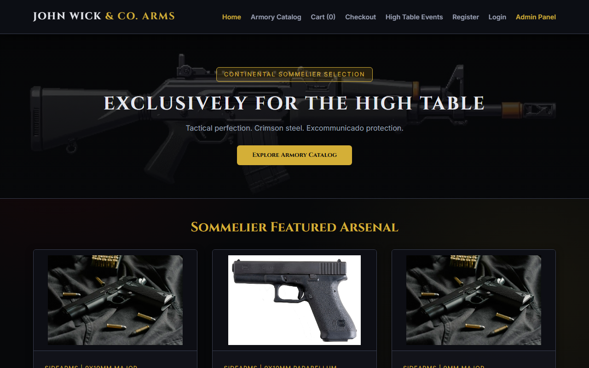
*Displays the Continental Hero Banner, Sommelier Selection, and featured weapons with prices and direct Add-to-Cart actions.*

### 2. Armory Catalog with Category Filter (`catalog.php`)
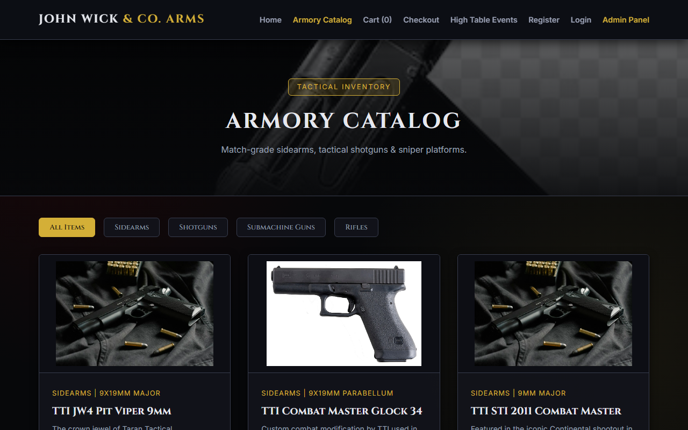
*Shows the complete armory catalog containing all 18 authentic weapons filtered dynamically by Sidearms, Shotguns, SMGs, and Rifles.*

### 3. Weapon Specification & Detail View (`weapon_detail.php`)
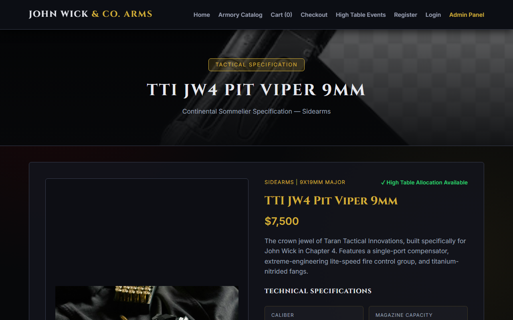
*Dedicated technical specification breakdown: Caliber, Capacity, Barrel Length, Effective Range, Sommelier tasting notes, and procurement controls.*

### 4. Operative Registration with Weapon Clearance (`register.php`)

*Registration form capturing Clearance Tier, Blood Oath Marker code, Duty Station, Phone, and Safehouse delivery coordinates.*

### 5. Operative Authentication with 1-Click Test User Auto-Fill (`login.php`)
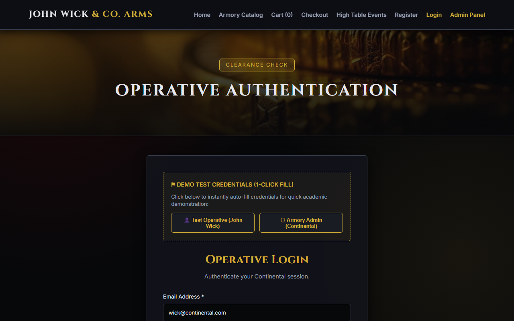
*Secure login page equipped with 1-click demo test credentials for rapid evaluation (`wick@continental.com` / `continental123`).*

### 6. Shopping Cart & Requisition Ledger (`cart.php`)
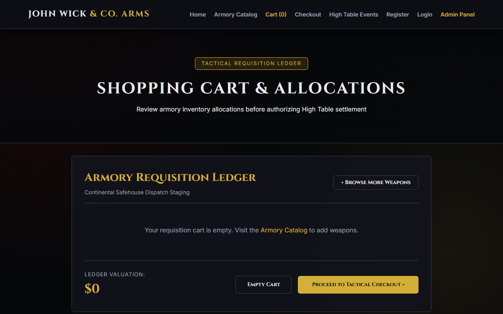
*Active shopping cart showing selected weapons, quantities, itemized subtotals, grand total in USD, and Continental Gold Coin equivalents.*

### 7. Requisition Checkout with 5 Professional Payment Options (`checkout.php`)
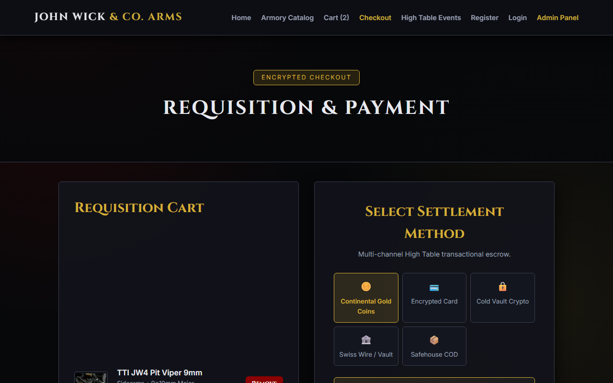
*Multi-channel settlement form featuring Continental Gold Coins, High Table Encrypted Card, Crypto Escrow, Swiss Wire, and Safehouse COD.*

### 8. Requisition Approved & Order Confirmation (`order_success.php`)
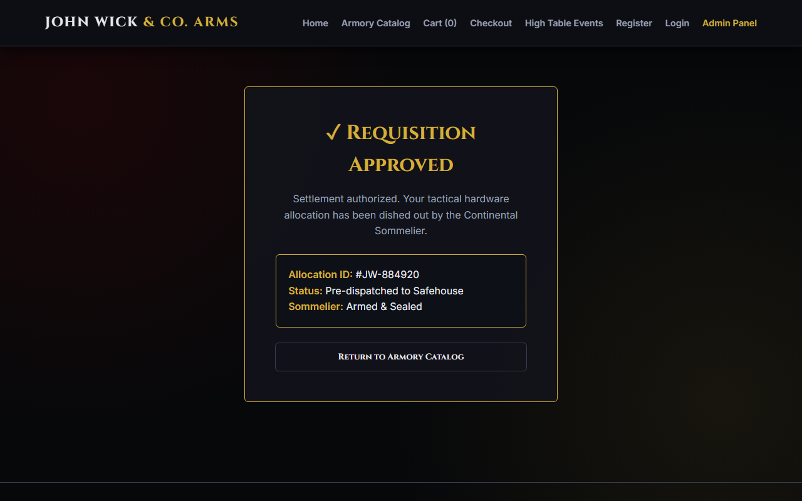
*Order approval confirmation screen displaying generated Order ID, authorized settlement method, delivery breakdown, and tracking links.*

### 9. Customer 'My Orders' History & Live Tracking (`my_orders.php`)
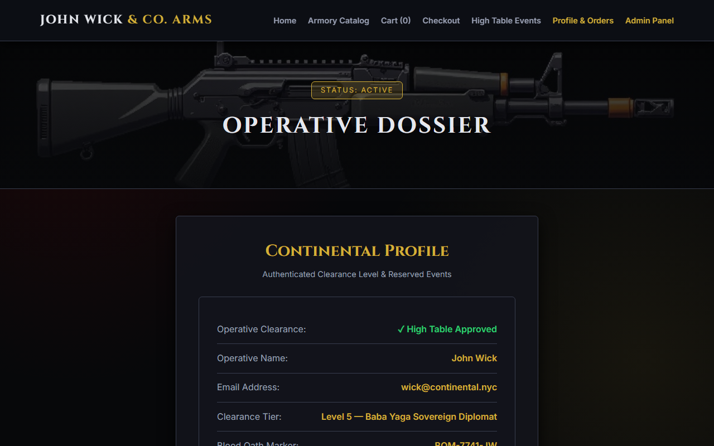
*Historical requisition log listing order IDs, items ordered, total amounts, settlement methods, and real-time status badges.*

### 10. Admin Command Center Authentication (`admin/index.php`)
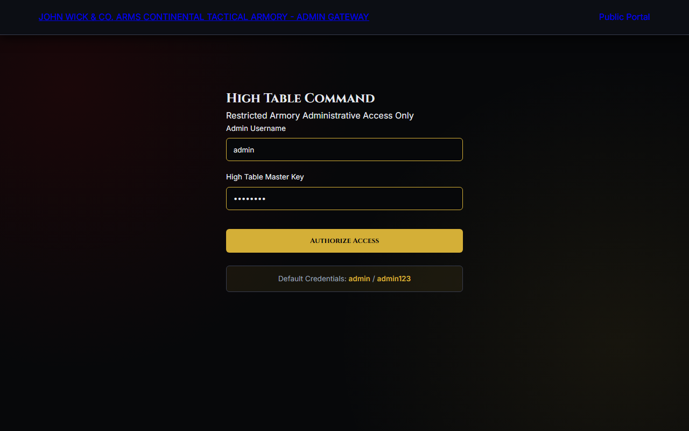
*Administrative login gateway protecting management functionality from unauthorized access (`admin` / `admin123`).*

### 11. Admin Command Dashboard & Analytics (`admin/dashboard.php`)
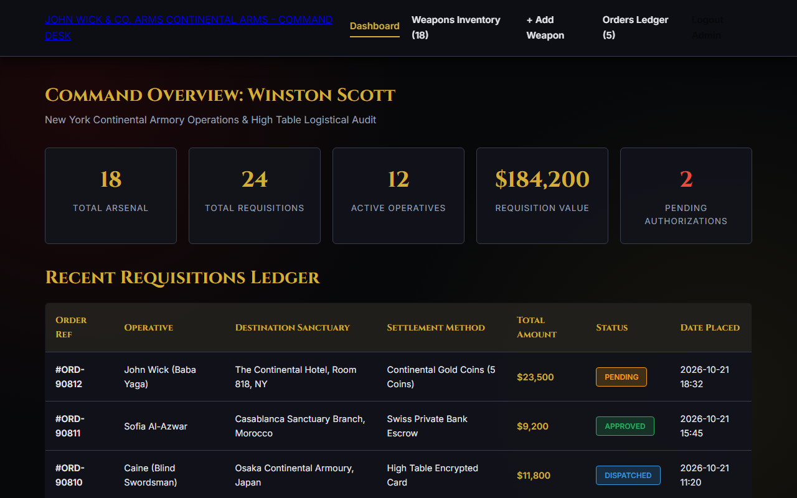
*Overview metrics showing Total Weapons in Armory, Total Orders, Registered Operatives, Revenue, and Recent Orders summary.*

### 12. Admin Weapon Inventory Management CRUD Table (`admin/weapons.php`)
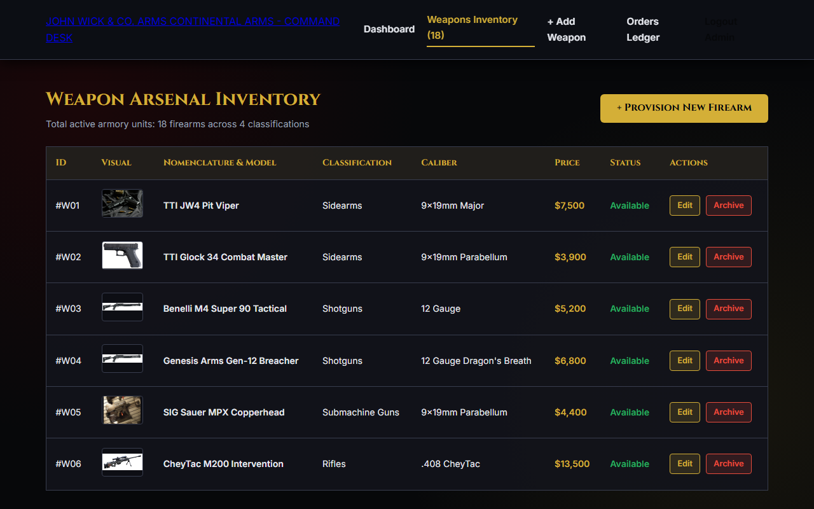
*CRUD inventory management table listing all tactical weapons with image previews, pricing, and Edit/Delete controls.*

### 13. Admin Add New Weapon Form (`admin/add_weapon.php`)
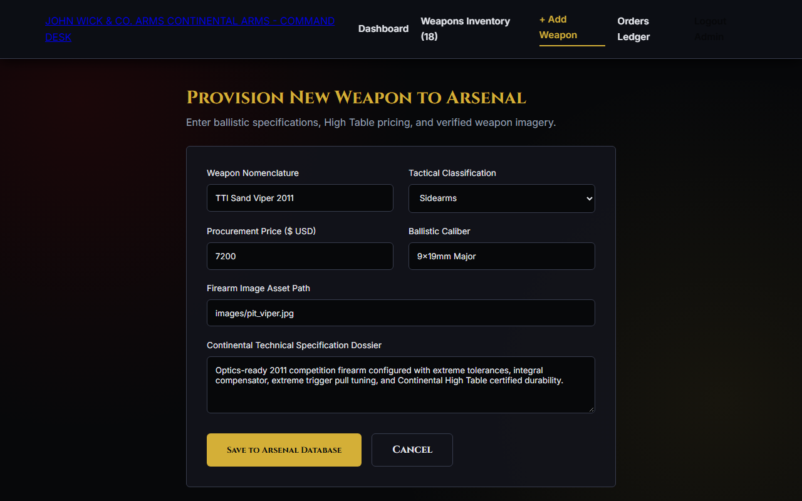
*Admin form to upload new armory items with category selection, caliber specification, price setting, description, and status controls.*

### 14. Admin Edit Weapon Specifications (`admin/edit_weapon.php`)
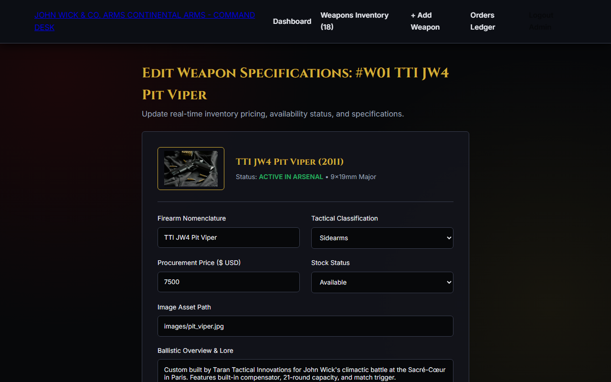
*Administrative modification form to update firearm specifications, pricing, and stock availability.*

### 15. Admin Customer Orders Management & Status Update (`admin/orders.php`)
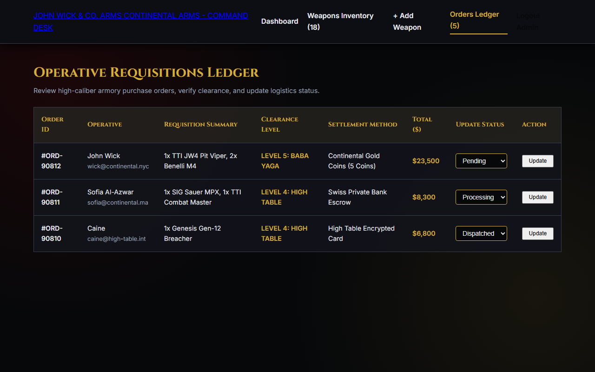
*Order management portal with status filtering and inline dropdown to update order status (Pending, Processing, Dispatched, Delivered).*

### 16. Relational Database Schema (`database/john_wick_arms.sql`)
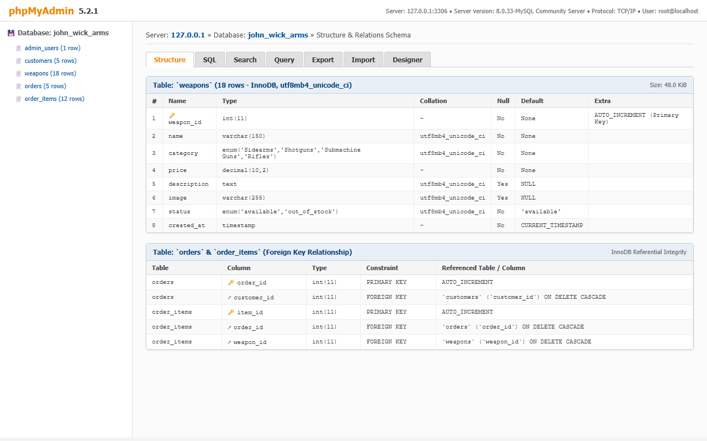
*Relational database structure illustrating admin_users, customers, weapons (18 items), orders, and order_items tables with foreign keys.*

---

## 🗄️ Relational Database Schema & Data Dictionary

The relational database is constructed in MySQL 8.0 / MariaDB utilizing InnoDB for strict referential integrity.

```text
  ┌───────────────────────┐             ┌─────────────────────────┐
  │      customers        │             │         orders          │
  ├───────────────────────┤             ├─────────────────────────┤
  │ PK  customer_id       │◄────┐       │ PK  order_id            │◄────┐
  │     full_name         │     │       │ FK  customer_id         │     │
  │     email (UNIQUE)    │     └───────┤     total_amount        │     │
  │     password          │             │     payment_method      │     │
  │     clearance_tier    │             │     delivery_name       │     │
  │     marker_code       │             │     delivery_phone      │     │
  │     duty_station      │             │     delivery_address    │     │
  │     phone             │             │     delivery_city       │     │
  │     address           │             │     delivery_zip        │     │
  │     created_at        │             │     order_status        │     │
  └───────────────────────┘             │     order_date          │     │
                                        └─────────────────────────┘     │
  ┌───────────────────────┐                                             │
  │      admin_users      │             ┌─────────────────────────┐     │
  ├───────────────────────┤             │       order_items       │     │
  │ PK  admin_id          │             ├─────────────────────────┤     │
  │     username (UNIQUE) │             │ PK  item_id             │     │
  │     password          │             │ FK  order_id            ├─────┘
  │     full_name         │             │ FK  weapon_id           ├─────┐
  │     created_at        │             │     quantity            │     │
  └───────────────────────┘             │     unit_price          │     │
                                        └─────────────────────────┘     │
                                                                        │
  ┌───────────────────────┐                                             │
  │        weapons        │                                             │
  ├───────────────────────┤                                             │
  │ PK  weapon_id         │◄────────────────────────────────────────────┘
  │     name              │
  │     category          │
  │     price             │
  │     caliber           │
  │     capacity          │
  │     description       │
  │     image             │
  │     status            │
  │     created_at        │
  └───────────────────────┘
```

### Table Definitions:
1. **`admin_users`**: Stores authenticated administrators of the Continental armory.
2. **`customers`**: Stores registered operatives, clearance ratings, and safehouse addresses.
3. **`weapons`**: Stores cataloged armaments with specs, pricing, and stock status.
4. **`orders`**: Records requisition transactions, payment channels, and delivery locations.
5. **`order_items`**: Associates weapons and quantities with individual orders (`ON DELETE CASCADE`).

---

## ⚙️ Setup & Installation Instructions

### Method 1: Local XAMPP / WAMP Setup

1. **Clone or Copy Repository**:
   Place the project into your local web server root directory:
   - **XAMPP**: `C:\xampp\htdocs\john-wick-arms\`
   - **WAMP**: `C:\wamp64\www\john-wick-arms\`

2. **Start Web Server & Database**:
   - Open the XAMPP / WAMP Control Panel.
   - Start the **Apache** and **MySQL** services.

3. **Import Database Schema**:
   - Open your browser to `http://localhost/phpmyadmin/`.
   - Click **New** and create a database named `john_wick_arms` with collation `utf8mb4_unicode_ci`.
   - Click the **Import** tab.
   - Choose file: `database/john_wick_arms.sql` and click **Import** (or **Go**).

4. **Access the System**:
   - **Operative Portal**: `http://localhost/john-wick-arms/index.php`
   - **Armory Catalog**: `http://localhost/john-wick-arms/catalog.php`
   - **Admin Command Center**: `http://localhost/john-wick-arms/admin/index.php`

---

### Method 2: 1-Click Docker Compose (Port 3000)

To guarantee that your local Apache server on Port 80/8080 is never conflicted, this repository includes a dedicated `docker-compose.yml` that binds the web application to **Port 3000** and MySQL to **Port 3306**:

```bash
# 1. Navigate to the project root
cd "d:\Akash Files\Akash L Clg Documents\Web prg\john-wick-arms"

# 2. Build and launch the containers in the background
docker-compose up -d --build

# 3. Access the containerized application
# Operative Portal: http://localhost:3000/
# Admin Portal:     http://localhost:3000/admin/
```

To stop the containers:
```bash
docker-compose down
```

---

## ☁️ Free-Tier Cloud Deployment Guide

### Vercel Deployment (Frontend)
1. **Push your code to GitHub**:
   ```bash
   git add .
   git commit -m "feat: complete John Wick Arms armory"
   git push -u origin main
   ```
2. Navigate to [Vercel](https://vercel.com/) and click **Add New... > Project**.
3. Import the `john-wick-arms` repository from your GitHub account (`akash-07-git-io`).
4. Keep the default settings (Root directory `./`, Framework preset `Other`).
5. Click **Deploy**. Vercel will serve `index.html` and rewrite routes according to `vercel.json` instantly.

---

### Render Cloud Deployment (Full-Stack)
1. Sign in to [Render](https://render.com/).
2. Click **New + > Web Service**.
3. Connect your GitHub repository `john-wick-arms`.
4. Render automatically reads `Dockerfile` and `render.yaml`.
5. Connect a free MySQL database (e.g. from [Aiven.io](https://aiven.io/) or [Clever Cloud](https://www.clever-cloud.com/)) and set the following environment variables in the Render Dashboard:
   - `DB_HOST`: Your remote MySQL hostname
   - `DB_USER`: Your remote database user
   - `DB_PASS`: Your remote database password
   - `DB_NAME`: Your remote database name
   - `DB_PORT`: `3306` (or provided port)
6. Click **Create Web Service**. Render builds the Docker image and hosts your live PHP 8.2 backend on a free `*.onrender.com` domain.

---

## 🔑 Default Credentials & Test Accounts

### 1. High Table Administrator
- **Login URL**: `/admin/index.php` (or `/admin_preview/login.html`)
- **Username**: `admin`
- **Password**: `admin123`
- **Role**: Full Armory CRUD, Inventory Management, Order Status Transitions.

### 2. High Table Operative (Customer Demo)
- **Login URL**: `/login.php`
- **Email**: `wick@continental.com`
- **Password**: `continental123`
- **Name**: John Wick
- **Clearance**: *Tier 3 — High Table Inner Circle*
- **Blood Oath Marker**: `BOM-0001-WICK`
- **Station**: New York Continental
- *(Tip: Click the gold "Auto-Fill John Wick" button on the login screen for 1-click test authentication).*

---

## 📋 Academic Assignment Scope & Legal Disclaimer

- **Course**: Web Programming & Internet Technologies
- **Assignment**: Assignment II — Weapon Management and Ordering System
- **Lead Developer**: Akash Logeshbabu (`akash-07-git-io`)
- **Institution**: College of Engineering / Department of Computer Science & Engineering
- **Academic Simulation Disclaimer**:  
  This software application is purely an educational, fictitious academic project inspired by cinematic universe themes. It does not facilitate, conduct, or endorse any real-world armament sales, weapons transactions, or violent activities. All product names, specifications, and references are property of their respective copyright holders.

---

## 📄 License
This project is distributed under the **MIT License** for academic and evaluation purposes. See the repository for details.

© 2026 John Wick & Co. Arms. Developed for Web Programming Assignment II.
